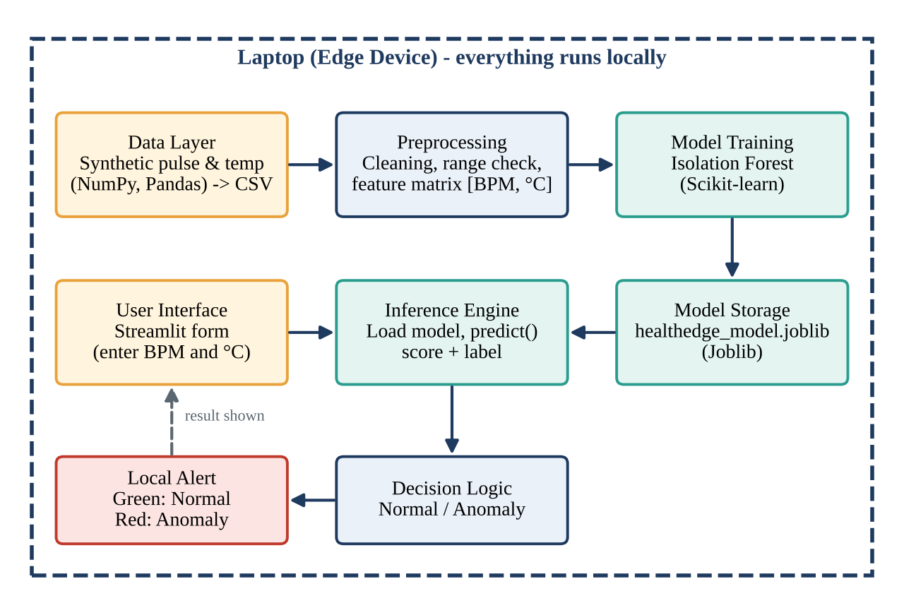
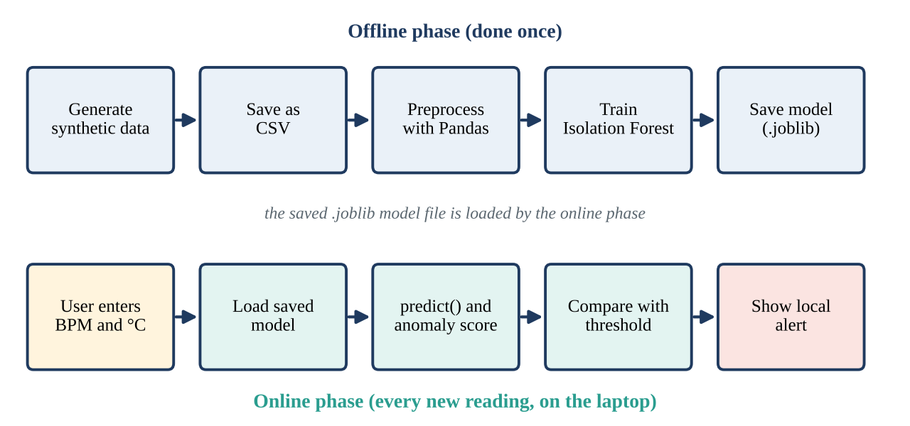
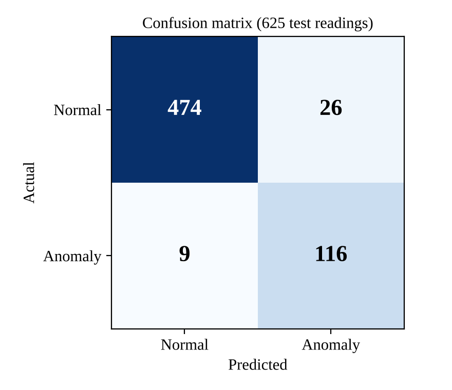
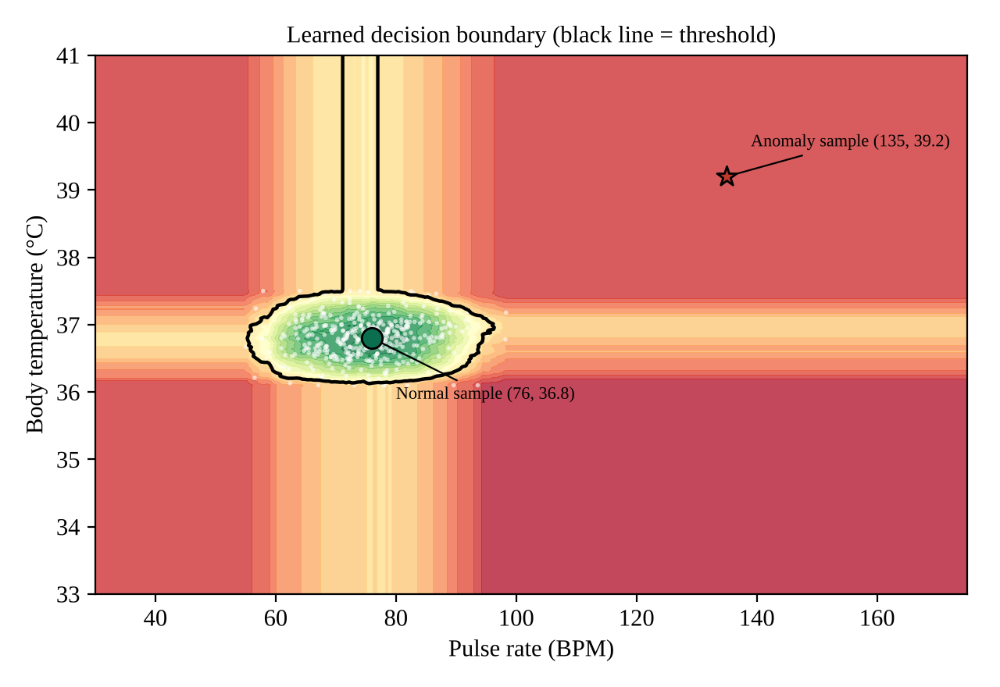

# HealthEdge: Edge AI Vital-Sign Anomaly Detection

   

HealthEdge checks whether a **pulse rate (BPM)** and **body temperature (°C)** reading looks normal or abnormal and raises a **local alert**. An **Isolation Forest** model, trained only on normal readings, runs **entirely on the laptop**: no cloud, no internet, no data leaves the device.

> ⚠️ **Educational prototype. Not a medical device and not a diagnosis tool.**

Edge AI CAT 3 project, B.Tech CSE, Dayananda Sagar University (2026-27).

---

## Table of Contents
1. [Features](#features)
2. [Why Edge AI?](#why-edge-ai)
3. [Architecture and Workflow](#architecture-and-workflow)
4. [Dataset: where the data comes from](#dataset-where-the-data-comes-from)
5. [Project Structure](#project-structure)
6. [Quick Start](#quick-start)
7. [Usage and Examples](#usage-and-examples)
8. [Results](#results)
9. [Limitations](#limitations)
10. [Future Work](#future-work)
11. [Tech Stack](#tech-stack)
12. [Team](#team)
13. [References](#references)
14. [License](#license)

## Features
- Synthetic dataset generation (NumPy + Pandas), stored as CSV
- Unsupervised anomaly detection with Scikit-learn **Isolation Forest** (trained on normal data only)
- Trained model saved and reloaded with Joblib
- Streamlit web interface: enter BPM and °C and get a green **Normal** or red **Anomaly** alert with a score
- Evaluation script: accuracy, precision, recall, F1, confusion matrix, latency, model size, optimisation study
- 100% offline inference

## Why Edge AI?
| | Cloud AI | HealthEdge (Edge AI) |
|---|---|---|
| Where prediction runs | Remote server | **This laptop** |
| Needs internet | Yes | **No** |
| Latency | Network round trip | **A few milliseconds** |
| Privacy | Data is uploaded | **Data stays on the device** |
| Running cost | Server / API cost | **None** |

## Architecture and Workflow



**Offline phase (once):** generate synthetic data → save CSV → train Isolation Forest → save `healthedge_model.joblib`.
**Online phase (every reading):** user enters BPM and °C → load saved model → `predict()` + anomaly score → show local alert.



## Dataset: where the data comes from

**No external or real-world dataset was used.** No sensors were available, so all data is **synthetic and generated by the code in this repository**.

| File | How it is created | Content |
|---|---|---|
| `data/healthedge_dataset.csv` | `python train_model.py` (seed 42) | 2,000 **normal** readings used for training |
| `data/healthedge_test.csv` | `python evaluate.py` (seed 42) | 625 labelled readings (500 normal, 125 abnormal) used only for evaluation |

**Generation rules**
- Normal pulse ~ Normal(mean 75, SD 8) BPM, clipped to 55-100
- Normal temperature ~ Normal(mean 36.8, SD 0.3) °C, clipped to 36.1-37.5
- These values were chosen to resemble typical resting adult ranges. They are assumptions for demonstration, not measured data.
- Abnormal test patterns (25 each): tachycardia + fever, tachycardia only, high fever only, bradycardia, hypothermia + low pulse
- The model **never sees abnormal data during training**

Because the data is simulated, the reported metrics show how the workflow behaves, **not clinical accuracy**. Public physiological databases such as [PhysioNet](https://physionet.org/) are suggested as future validation sources but were **not** used in this project.

## Project Structure
```
HealthEdge/
├── app.py                  # Streamlit interface (entry point)
├── train_model.py          # Generates dataset, trains and saves the model
├── evaluate.py             # Metrics, latency, model size, optimisation study
├── requirements.txt
├── data/
│   ├── healthedge_dataset.csv   # training data (normal only)
│   └── healthedge_test.csv      # labelled test data
├── tests/
│   └── test_model.py       # smoke test for the two demo examples
├── docs/
│   ├── HealthEdge_Report.pdf    # full project report
│   ├── results_reference_run.json
│   └── figures/            # diagrams and result plots
├── LICENSE
└── README.md
```
`healthedge_model.joblib` is created by `train_model.py` and is intentionally not committed, so the model always matches your installed scikit-learn version.

## Quick Start

```bash
# 1. Clone
git clone https://github.com/<your-username>/HealthEdge.git
cd HealthEdge

# 2. (Optional) virtual environment
python -m venv venv
source venv/bin/activate        # Windows: venv\Scripts\activate

# 3. Install
pip install -r requirements.txt

# 4. Train (creates data/healthedge_dataset.csv and healthedge_model.joblib)
python train_model.py

# 5. Run the app (opens http://localhost:8501)
streamlit run app.py
```

**Optional**
```bash
python evaluate.py     # prints/saves metrics, latency, model size, optimisation table
pytest                 # runs the smoke test
```

## Usage and Examples
Enter values in the app and press **Check Vitals**.

| Pulse (BPM) | Temperature (°C) | Result |
|---|---|---|
| 76 | 36.8 | ✅ Normal |
| 135 | 39.2 | 🚨 Anomaly |

These are demonstration examples, not medical diagnoses.

## Results
Reference run on a CPU-only machine (Python 3.12, scikit-learn 1.9.1), `n_estimators=100`, `contamination=0.05`, 625 test readings:

| Metric | Value |
|---|---|
| Accuracy | 94.4% |
| Precision | 81.7% |
| Recall | 92.8% |
| F1-score | 86.9% |
| False-alarm rate | 5.2% |
| Model size | ~1.35 MB (about 376 KB compressed) |
| Latency per reading | ~6 ms (single reading, CPU) |

Latency and size depend on your machine and library versions, so run `python evaluate.py` to reproduce your own figures.

**Model optimisation (trees vs size / speed):** a 50-tree model is about half the size and roughly 40% faster than 100 trees with no loss in F1 (0.904 vs 0.869 in this run). See Table 5 in the report.

| Confusion matrix | Decision boundary |
|---|---|
|  |  |

## Limitations
- Simulated data only; no real patient readings
- No physical sensors, ESP32 or Raspberry Pi in this version
- **Known weak spot:** fever-only readings can be missed (about 64% detected). For example 75 BPM with 40 °C is classified as normal because the pulse sits in the densest part of the training data
- Alert sensitivity depends on the `contamination` setting
- Only two features; not a medical device

## Future Work
- Hybrid safeguard: hard clinical limits plus the ML model for unusual combinations
- Real sensors (MAX30102 pulse, DS18B20 temperature) on Raspberry Pi, then a compact model on ESP32
- More signals (SpO₂, heart-rate variability), trend analysis over time and a personal baseline
- Validation on public physiological datasets and comparison with One-Class SVM, LOF and autoencoders

## Tech Stack
Python · NumPy · Pandas · Scikit-learn (IsolationForest) · Joblib · Streamlit · CSV

## Team
| Name | USN |
|---|---|
| Pruthvi V P | ENG24CS1013 |
| Sanjana S Katti | ENG23CS0175 |
| Shaik Saara Shireen | ENG23CS0179 |
| Shubha A | ENG23CS0187 |
| Sree Shanth K H | ENG23CS0194 |

## References
1. F. T. Liu, K. M. Ting, Z.-H. Zhou, "Isolation Forest," IEEE ICDM, 2008.
2. F. Pedregosa et al., "Scikit-learn: Machine Learning in Python," JMLR 12, 2011.
3. W. Shi et al., "Edge Computing: Vision and Challenges," IEEE Internet of Things Journal, 2016.
4. Full reference list: see `docs/HealthEdge_Report.pdf`.

## License
Released under the [MIT License](LICENSE).
